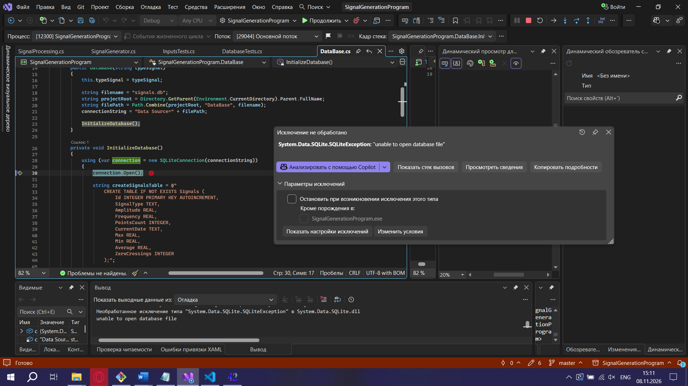
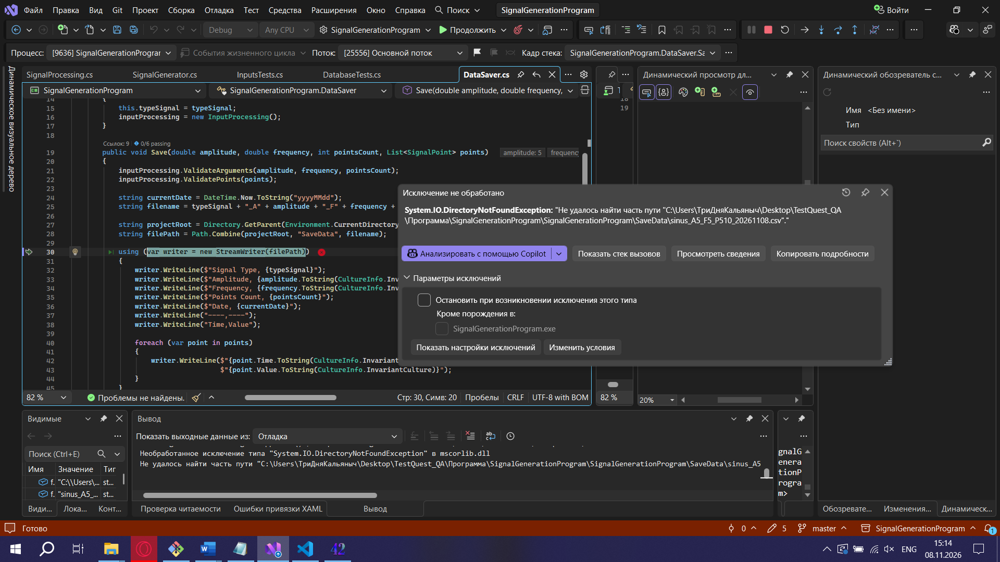
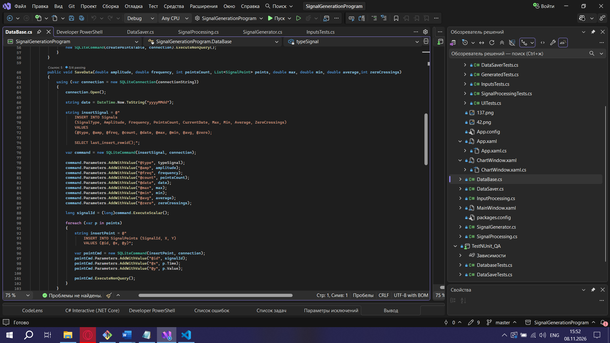
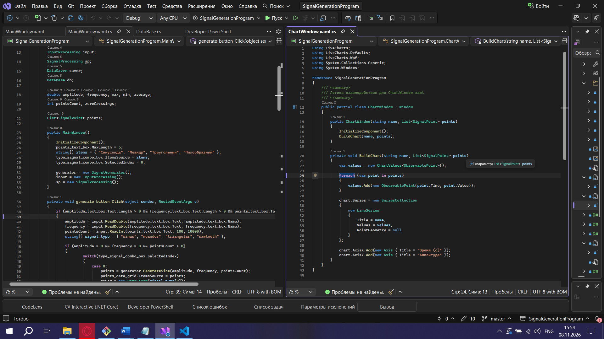
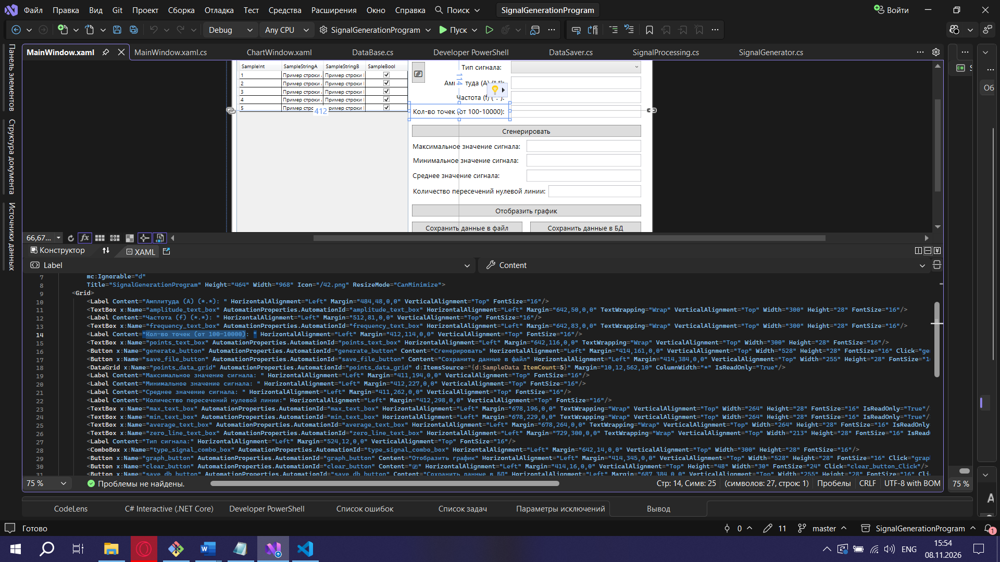
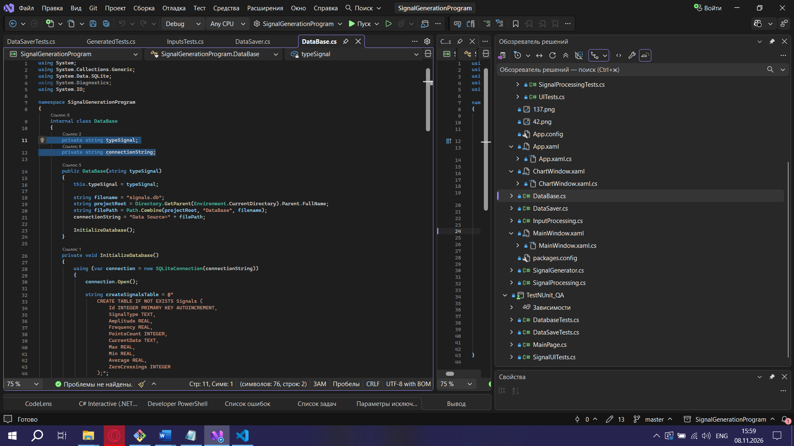
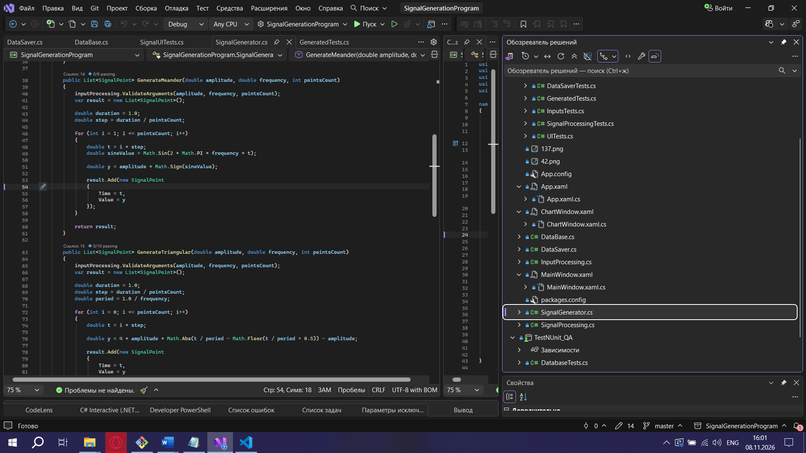

# Отчет об обнаруженных дефектах (Bug Reports) и аудит кодовой базы

В данном документе представлены детальные баг-репорты, составленные по результатам ручного исследовательского и автоматизированного UI-тестирования приложения SignalGenerationProgram v1.0.

---

## 1. Критический дефект окружения директории DataBase

* **Заголовок:** Аварийное завершение работы при сохранении данных в БД из-за отсутствия папки DataBase
* **Окружение:** Windows 10/11 x64, SignalGenerationProgram v1.0, .NET Framework 4.8
* **Предусловия:** Приложение запущено, в корневом каталоге сборки (`..\bin\Debug\`) физически отсутствует папка `DataBase`.
* **Шаги воспроизведения:**
  1. Выбрать любой тип сигнала в интерфейсе приложения.
  2. Заполнить параметры валидными значениями (Амплитуда = 5, Частота = 2, Точек = 500).
  3. Нажать кнопку «Сгенерировать».
* **Фактический результат:** Приложение аварийно завершает работу и мгновенно закрывается без вывода диагностических сообщений об ошибке (`DirectoryNotFoundException`).
* **Ожидаемый результат:** Приложение должно автоматически проверять наличие папки и создавать отсутствующую директорию программными средствами перед записью SQLite-файла, либо корректно обрабатывать исключение, выводя информативное окно `MessageBox`.
* **Скриншот/видео:** 

---

## 2. Критический дефект окружения директории SaveData

* **Заголовок:** Аварийное завершение работы при экспорте в CSV из-за отсутствия папки SaveData
* **Окружение:** Windows 10/11 x64, SignalGenerationProgram v1.0, .NET Framework 4.8
* **Предусловия:** Приложение запущено, в корневом каталоге сборки (`..\bin\Debug\`) отсутствует папка `SaveData`.
* **Шаги воспроизведения:**
  1. Заполнить поля валидными параметрами и нажать кнопку «Сгенерировать».
  2. Нажать кнопку «Сохранить данные в файл».
* **Фактический результат:** Происходит мгновенный краш процесса приложения без уведомления пользователя.
* **Ожидаемый результат:** Автоматическое создание папки `SaveData` при ее отсутствии перед записью файловым потоком `StreamWriter` или вывод предупреждения в диалоговом окне.
* **Скриншот/видео:** 

---

## 3. Дефект блокировки интерфейса при сохранении данных в БД

* **Заголовок:** Замораживание графического интерфейса в процессе записи данных в SQLite
* **Окружение:** Windows 10/11 x64, SignalGenerationProgram v1.0
* **Предусловия:** Сигнал успешно сгенерирован, на форме отображается таблица точек.
* **Шаги воспроизведения:**
  1. Нажать на кнопку «Сохранить данные в БД».
  2. Попытаться переместить окно приложения или переключить вкладки в процессе сохранения.
* **Фактический результат:** Главное окно программы замерзает на время выполнения операции записи, интерфейс переходит в статус «Не отвечает» и не реагирует на действия пользователя.
* **Ожидаемый результат:** Тяжелые операции ввода-вывода и транзакции к БД должны выполняться асинхронно в фоновом потоке с использованием `async/await`, оставляя UI-поток свободным.
* **Скриншот/видео:** 

---

## 4. Дефект отсутствия глобальных и локальных конструкций try-catch

* **Заголовок:** Отсутствие блоков перехвата исключений (try-catch) в обработчиках бизнес-логики и запросах СУБД
* **Окружение:** Кодовая база SignalGenerationProgram v1.0, файлы `*.xaml.cs` и `*.cs`
* **Предусловия:** Доступ к исходному коду проекта.
* **Шаги воспроизведения:**
  1. Провести статический аудит обработчиков событий кнопок интерфейса.
  2. Проверить методы выполнения SQL-команд `INSERT INTO` в блоках работы с базой данных.
* **Фактический результат:** Конструкции `try-catch` полностью отсутствуют в критических узлах бэкенда. Любая непредвиденная ошибка на уровне базы данных или файловой системы валит весь процесс приложения.
* **Ожидаемый результат:** Все участки взаимодействия с внешними ресурсами должны быть защищены блоками `try-catch` для безопасного логирования ошибок и вывода модальных окон пользователю.
* **Скриншот/видео:** 

---

## 5. Дефект нарушения паттерна архитектуры MVVM

* **Заголовок:** Полное отсутствие архитектурного разделения слоев по паттерну MVVM в WPF-проекте
* **Окружение:** Архитектура решения SignalGenerationProgram v1.0
* **Предусловия:** Анализ структуры проекта в Solution Explorer Visual Studio.
* **Шаги воспроизведения:**
  1. Проверить файловую структуру папок проекта.
  2. Открыть файлы `MainWindow.xaml.cs` (Code-behind).
* **Фактический результат:** Бизнес-логика, математические расчеты и SQL-запросы жестко зашиты прямо внутри обработчиков событий элементов разметки. Отсутствуют слои Models и ViewModels, что делает невозможным изолированное модульное тестирование.
* **Ожидаемый результат:** Архитектура должна соответствовать паттерну MVVM: View общается с ViewModel посредством привязок данных и команд, а бизнес-логика изолирована в слое Model.
* **Скриншот/видео:** 

---

## 6. Дефект позиционирования элементов на View (Адаптивность)

* **Заголовок:** Нарушение верстки графического интерфейса и отсутствие адаптивности элементов формы при масштабировании
* **Окружение:** Окно разметки формы MainWindow.xaml
* **Предусловия:** Приложение успешно запущено.
* **Шаги воспроизведения:**
  1. Попытаться изменить размеры главного окна приложения (максимизировать на весь экран или сжать).
* **Фактический результат:** Элементы интерфейса жестко зафиксированы. При изменении размера окна разметка ломается, поля вывода накладываются друг на друга. В разметке XAML вместо адаптивных контейнеров `Grid` (с относительными долями `*`) и `StackPanel` использованы статические отступы `Margin` с огромными значениями.
* **Ожидаемый результат:** Верстка должна быть полностью адаптивной, резиновой и корректно масштабироваться под любые разрешения экранов за счет правильного использования контейнеров и сеток.
* **Скриншот/видео:** 

---

## 7. Критический дефект производительности при постройке графов

* **Заголовок:** Блокировка UI-потока (UI Freeze) и зависание окна графиков при выборке от 3000 точек
* **Окружение:** Окно ChartWindow.xaml, библиотека LiveCharts
* **Предусловия:** Сгенерирован валидный сигнал с объемом точек более 3000.
* **Шаги воспроизведения:**
  1. Указать в поле точек значение `5000` (или `10000`).
  2. Нажать «Сгенерировать», затем нажать кнопку «Отобразить график».
* **Фактический результат:** Окно графика надолго зависает. Метод `BuildChart()` в конструкторе `ChartWindow.xaml.cs` вызывается синхронно, блокирует главный поток и перегружает графический конвейер WPF.
* **Ожидаемый результат:** Отрисовка больших графиков должна быть оптимизирована, тяжелые расчеты вынесены из конструктора формы, а визуализация должна использовать асинхронный вызов.
* **Скриншот/видео:** 

---

## 8. Критический дефект транзакционности базы данных

* **Заголовок:** Отсутствие контроля целостности данных (Transaction, Commit, Rollback) при пакетной циклической записи в БД
* **Окружение:** Блок взаимодействия с SQLite в кодовой базе бэкенда
* **Предусловия:** Анализ SQL-кода выполнения операций записи.
* **Шаги воспроизведения:**
  1. Запустить генерацию сигнала на 1000 точек.
  2. Нажать кнопку «Сохранить данные в БД» и сымитировать сбой.
* **Фактический результат:** Программа выполняет запись циклом построчно, отправляя сотни отдельных `execute`-запросов без открытия транзакции (`SqliteTransaction`). При сбое в базе остается поврежденный, частично записанный массив данных. Механизмы Rollback отсутствуют.
* **Ожидаемый результат:** Пакетная вставка большого массива точек должна происходить строго внутри единой транзакции с вызовами `transaction.Commit()` при успехе и автоматическим `transaction.Rollback()` при возникновении любого исключения.
* **Скриншот/видео:** 

---

## 9. Дефект именования закрытых полей по гайдлайнам C#

* **Заголовок:** Нарушение общепринятых правил именования закрытых полей классов (Code Style Microsoft)
* **Окружение:** Файлы исходного кода бэкенда `.cs`
* **Предусловия:** Статический анализ кода решения.
* **Шаги воспроизведения:**
  1. Изучить объявление закрытых (private) переменных внутри классов бизнес-логики.
* **Фактический результат:** Закрытые поля классов названы без использования обязательного префикса нижнего подчеркивания, что усложняет чтение и поддержку кода.
* **Ожидаемый результат:** Строгое соответствие официальному гайдлайну Microsoft: закрытые поля должны начинаться с символа `_` и camelCase записи.
* **Скриншот/видео:** 

---

## 10. Дефект инкапсуляции методов бизнес-логики

* **Заголовок:** Нарушение инкапсуляции: необоснованное использование модификатора доступа public для внутренних служебных методов
* **Окружение:** Классы ядра бизнес-логики приложения
* **Предусловия:** Просмотр сигнатур методов в классах генерации.
* **Шаги воспроизведения:**
  1. Открыть класс генерации сигналов.
  2. Проверить модификаторы доступа вспомогательных утилитарных методов расчетов.
* **Фактический результат:** Служебные внутренние методы, которые не должны быть видны внешним классам, объявлены как `public`. Это грубо нарушает базовый принцип ООП — инкапсуляцию.
* **Ожидаемый результат:** Внутренние методы расчетов, валидации и проверок должны быть надежно скрыты внутри классов с помощью модификаторов `private` или `protected`.
* **Скриншот/видео:** 

---
